# NotePad Android 记事本应用扩展实验报告

本项目基于 Android 官方早期 `NotePad` SQLite `ContentProvider` 示例工程进行逐项扩展与重构，在不引入任何第三方依赖的前提下，完整实现了**列表时间戳与精准更新**、**标题与正文联合搜索**两项基础功能，以及**极光毛玻璃主题／深浅色切换／编辑器纸张背景／自适应无黑边应用图标**与**单条 TXT 导出／整本 JSON 备份格式／HTTPS WebDAV 云备份与单事务云恢复**两组自选扩展功能。

本文档同时作为本项目的完整实验报告（对应任务 T10 综合验收交付），按开发演进顺序详细记录系统设计、核心源码实现、典型问题排查及实机／模拟器测试结果与运行截图。

---

## 一、项目概览与技术环境

### 1.1 技术栈与运行环境

| 项目 | 配置与说明 |
| --- | --- |
| 开发语言与架构 | Java 8、XML 布局、原生 `Activity` / `ListActivity`、`ContentResolver`、SQLite `ContentProvider`（零第三方库依赖） |
| SDK 版本范围 | `minSdk 19`（Android 4.4 KitKat）、`targetSdk 36`（Android 16） |
| 数据库与表结构 | `note_pad.db` → `notes` 表（`_id`、`title`、`note`、`created`、`modified`，时间均为 Unix 毫秒整数，默认按 `modified DESC` 排序） |
| 主要验证环境 | Pixel 9 AVD（Android 16 / API 36 与 Android 17 / API 37）、`NotePad_T04_KitKat` AVD（Android 4.4.2 / API 19） |
| 自动化测试框架 | Android JUnit 3 Instrumentation（`ProviderTestCase2`、`ActivityInstrumentationTestCase2`、`AndroidTestCase`），共 7 个测试类 |

### 1.2 功能完成总览

| 模块类别 | 编号 | 功能说明 | 状态 |
| --- | --- | --- | --- |
| 基线对照 | T01 | 梳理原版源码数据流、保留原版界面截图与行为基线 | 已验收 |
| 基础功能 | T02 | 列表展示最后修改时间；正文与标题改写精准推进修改时间、仅查看不误改 | 已验收 |
| 基础功能 | T03 | 单输入框实时联合搜索标题与正文；特殊字符按字面匹配、保留排序与真实行 ID | 已验收 |
| 扩展一（UI 与编辑器） | T04 | 中文清新极光毛玻璃卡片列表、正文摘要与命中高亮、深浅色实时切换与圆形揭示动画、双插画空状态、圆角浮动改标题弹窗、无黑边自适应应用图标 | 已验收 |
| 扩展一（UI 与编辑器） | T05 | 圆角纸张卡片编辑器、等距自适应中文横线绘制、白纸／暖纸切换与全局记忆、保态切换且不误改时间戳 | 已验收 |
| 扩展二（导出与云同步） | T06 | 列表长按将单条笔记通过 SAF 系统文档创建器导出为 UTF-8 `.txt` 文件 | 已验收 |
| 扩展二（导出与云同步） | T07 | 整本笔记 UTF-8 JSON 快照编解码器与严格类型／结构校验 | 已验收 |
| 扩展二（导出与云同步） | T08 | HTTPS WebDAV 手动备份整本笔记，掩码应用密码不落盘，支持确认与错误分类 | 部分验证（真实公网云盘账号待补测） |
| 扩展二（导出与云同步） | T09 | HTTPS WebDAV 下载校验并在单次 SQLite 事务内增量补录缺失笔记，异常整批回滚 | 部分验证（真实公网云盘账号待补测） |
| 综合验收 | T10 | 全流程联调、API 37 与 API 19 全量自动化测试与实验报告整理 | 已完成报告（保留云盘实测缺口说明） |

---

## 二、项目代码结构

```text
app/src/
├── main/
│   ├── AndroidManifest.xml                       # 权限声明、Activity 注册与自适应应用图标配置
│   ├── java/com/example/android/notepad/
│   │   ├── NotePad.java                          # 数据契约：表名、列名、URI 与 MIME 常量
│   │   ├── NotePadProvider.java                  # SQLite ContentProvider、text/plain 管道输出、单事务恢复入口
│   │   ├── NotesList.java                        # 笔记列表：时间/摘要绑定、实时搜索高亮、主题切换、长按导出与云备份入口
│   │   ├── NoteEditor.java                       # 正文编辑器：LinedEditText 横线绘制、白纸/暖纸切换与精准保存
│   │   ├── TitleEditor.java                      # 修改标题浮动对话框：内容差异比较与修改时间更新
│   │   ├── NotesLiveFolder.java                  # 原版实时文件夹入口
│   │   ├── AuroraView.java                       # 列表底层动态三色极光柔光背景 View
│   │   ├── ThemeHelper.java                      # 深浅色/跟随系统与纸张偏好管理、系统栏适配与圆形揭示过渡动画
│   │   ├── NoteExporter.java                     # 单条笔记安全文件名清理与 UTF-8 纯文本流复制工具
│   │   ├── NoteBackupFormat.java                 # 整本笔记 JSON 快照读取、编解码与严格校验
│   │   ├── WebDavClient.java                     # 原生 HttpURLConnection HTTPS WebDAV PUT/GET 客户端
│   │   └── CloudBackupActivity.java              # WebDAV 云备份与恢复配置及异步传输界面
│   └── res/
│       ├── layout/                               # notes_list、noteslist_item、note_editor、title_editor、activity_cloud_backup 等
│       ├── menu/                                 # list_options_menu、list_context_menu、editor_options_menu
│       ├── values/ & values-night/ & values-v*/  # 浅色/深色语义色板、分层主题、中文文案与间距
│       ├── drawable/ & drawable-night/ & anim/   # 毛玻璃卡片、胶囊输入框、矢量图标、空状态插画与转场动画
│       └── mipmap-anydpi-v26/ & mipmap-*/        # Android 8.0+ 自适应图标与低版本无黑边图标资源
└── androidTest/java/com/example/android/notepad/
    ├── NotePadProviderTest.java                  # Provider CRUD、MIME 与 text/plain 管道回归测试（9 项）
    ├── NotePadActivityTest.java                  # NotesList 启动验证（1 项）
    ├── NoteEditorPaperTest.java                  # 140 段中文长文换纸保态、选区滚动与不改时间测试（1 项）
    ├── NoteExporterTest.java                     # 文件名清理、中文多行导出、同名区分、覆写截断与异常保护（5 项）
    ├── NoteBackupFormatTest.java                 # 空库往返、四字段精确对照与 16 类非法输入拒绝测试（3 项）
    ├── WebDavClientTest.java                     # HTTPS 规范化、PUT/GET 协议头、状态码分类与不泄露密码测试（6 项）
    └── NoteRestoreTest.java                      # 单事务合并、幂等去重、同名异文与中途失败整批回滚测试（4 项）
```

---

## 三、开发过程、核心代码与运行结果

### 3.1 原版基线梳理与行为核对（T01）

在修改代码前，先对官方原版 `NotePad` 进行了完整的源码走读与模拟器基线实测，确认了可复用的底层能力及需要修正的边界问题：

1. **可直接复用的底层能力**：
   - `NotePadProvider` 的 `notes` 表已自带毫秒级 `created`、`modified` 两列，默认排序为 `modified DESC`，`query()` 已向 SQLite 透传 `selection` 与 `selectionArgs`。
   - `NotePadProvider` 已通过 `getStreamTypes()`、`openTypedAssetFile()` 与 `writeDataToPipe()` 为单条笔记 URI 提供 `text/plain` 管道流，按 UTF-8 输出“标题 + 空行 + 正文”。
2. **发现的原版边界缺陷**：
   - `NoteEditor.onPause()` 在用户仅打开查看笔记后直接返回时，仍会无条件调用 `updateNote()` 覆盖 `modified`，导致未改动的笔记被错误刷新时间并置顶。
   - `TitleEditor.onPause()` 仅更新 `title` 字段，未同步更新 `modified`，导致修改标题后列表时间与排序不变化。

| 原版笔记列表（仅标题、深色单行） | 原版正文编辑器（基础横线与默认菜单） |
| :---: | :---: |
| 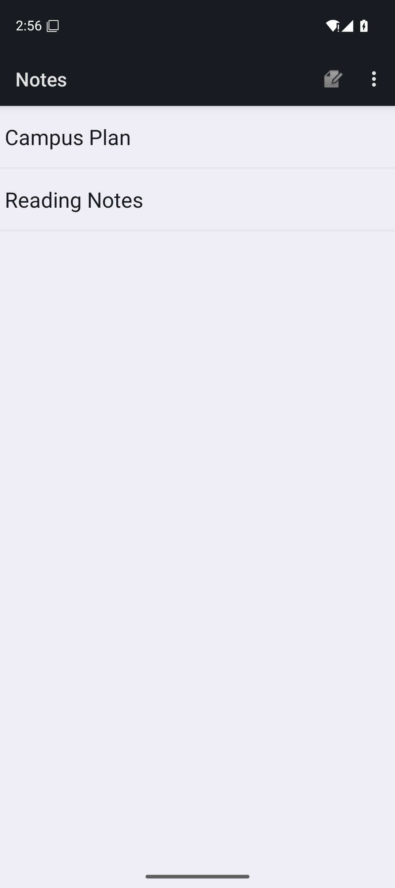 | 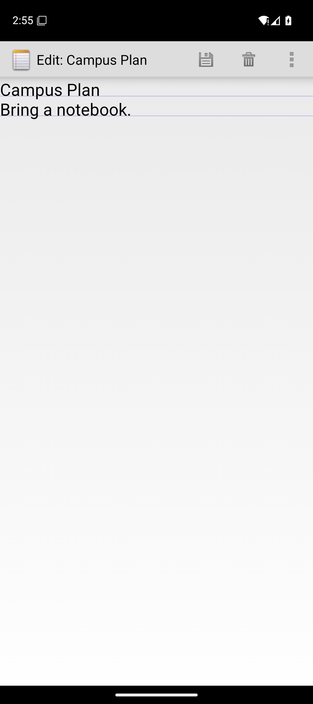 |

---

### 3.2 基础功能一：列表显示最后修改时间与精准更新时间（T02）

#### 设计思路
继续沿用原有数据库表、`NotePad.Notes.CONTENT_URI` 与 `modified DESC` 默认排序，不做表结构迁移，保证历史笔记数据可直接展示。针对 T01 发现的两处时间边界问题，分别在正文保存与修改标题入口引入实际内容比较逻辑。

#### 核心实现
1. **列表查询与时间绑定**（`NotesList.java`、`noteslist_item.xml`）：
   - 在 `PROJECTION` 中保留 `_id`（列 0）和 `title`（列 1）的索引位置，追加 `modified`，通过 `SimpleCursorAdapter.ViewBinder` 将毫秒时间戳格式化为本地日期和时间；对历史记录中 `modified IS NULL` 的行显示占位文本，避免误显为 1970 年。
2. **正文保存差异比较**（`NoteEditor.java`）：
   - 在 `updateNote(String text, String title)` 中分别比对当前正文与已保存正文、传入标题与已保存标题，仅当至少一项发生实质变化时才写入新的 `System.currentTimeMillis()`。

```java
// NoteEditor.java - 仅提交发生变化的字段，避免仅查看时推进修改时间
ContentValues values = new ContentValues();
if (!text.equals(getSavedNoteText())) {
    values.put(NotePad.Notes.COLUMN_NAME_NOTE, text);
}
int titleColumn = mCursor.getColumnIndexOrThrow(NotePad.Notes.COLUMN_NAME_TITLE);
if (title != null && !title.equals(mCursor.getString(titleColumn))) {
    values.put(NotePad.Notes.COLUMN_NAME_TITLE, title);
}

// 正文和标题都无变化时直接返回，避免仅查看时推进修改时间。
if (values.size() == 0) {
    return;
}
values.put(NotePad.Notes.COLUMN_NAME_MODIFICATION_DATE, System.currentTimeMillis());
```

3. **修改标题同步更新时间**（`TitleEditor.java`）：
   - 在 `onPause()` 中对比当前输入与数据库原标题，仅在实际改名时同时提交 `title` 与 `modified`；原样确认或未改动时直接返回。

```java
// TitleEditor.java - 只有实际改名才写入新标题和修改时间
String savedTitle = mCursor.getString(COLUMN_INDEX_TITLE);
String title = mText.getText().toString();
if (title.equals(savedTitle == null ? "" : savedTitle)) {
    return;
}
ContentValues values = new ContentValues();
values.put(NotePad.Notes.COLUMN_NAME_TITLE, title);
values.put(NotePad.Notes.COLUMN_NAME_MODIFICATION_DATE, System.currentTimeMillis());
```

#### 验证结果
在模拟器实测了历史笔记展示、编辑较早笔记后置顶、仅改标题更新排序、只看不改保留原时间、撤销改动保留原时间、缺失 `modified=NULL` 显示占位以及新建空白笔记自动清理等 7 个场景，同时通过 `content query` 核对底层毫秒值均准确无误。

| 编辑正文前（较新的 `Campus Plan` 在首行） | 编辑较早笔记 `Reading Notes` 正文后（时间更新并置顶） |
| :---: | :---: |
| 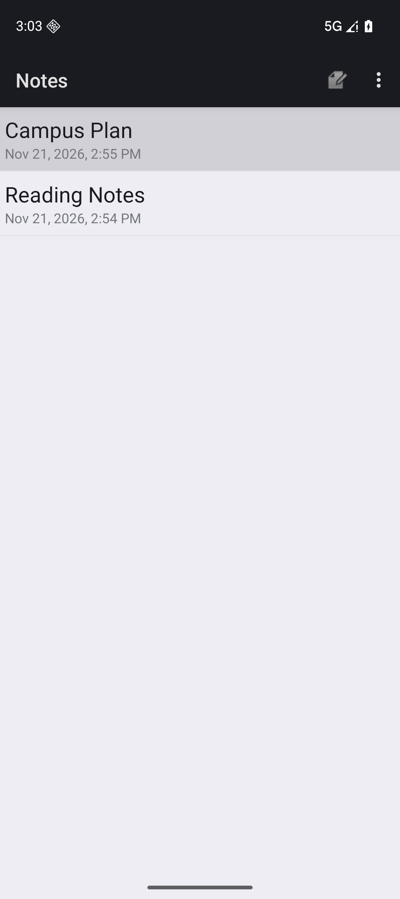 | 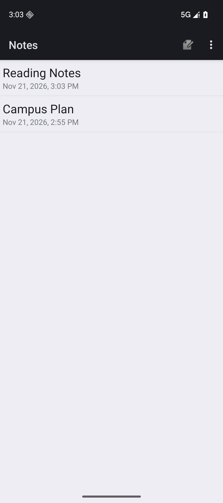 |

---

### 3.3 基础功能二：标题与正文联合搜索（T03）

#### 设计思路
在 `NotesList` 中复用传入的集合 URI、原有投影与 `modified DESC` 排序，构造参数化的 SQL `LIKE` 查询同时匹配 `title` 与 `note`。所有用户输入通过 `selectionArgs` 绑定传递，并对 SQL `LIKE` 通配符做显式转义，杜绝注入风险与通配符误匹配。

#### 核心实现（`NotesList.java`）
- **特殊字符转义与空白判断**：先转义反斜杠 `\`，再转义 `%` 和 `_`，配合 `ESCAPE '\'` 使单引号、百分号、下划线和反斜杠均按字面字符匹配；使用正则 `[\s\p{Z}]*` 将半角/全角空白统一视为无搜索词，自动恢复全量列表。
- **游标与状态管理**：通过 `adapter.changeCursor(...)` 自动关闭旧游标，`onDestroy()` 传入 `null` 释放最后一个游标；`onSaveInstanceState()` 保存 `searchQuery` 以支持屏幕旋转恢复；`onResume()` 按当前搜索词刷新结果。点击、长按删除、长按修改标题均基于结果行的真实 `info.id` 构造 URI。

```java
// NotesList.java - 联合匹配标题与正文，并对 LIKE 通配符显式转义
private static final String SEARCH_SELECTION =
        "(" + NotePad.Notes.COLUMN_NAME_TITLE + " LIKE ? ESCAPE '\\' OR "
                + NotePad.Notes.COLUMN_NAME_NOTE + " LIKE ? ESCAPE '\\')";

private void refreshNotes() {
    String selection = null;
    String[] selectionArgs = null;
    boolean searching = !BLANK_QUERY.matcher(searchQuery).matches();
    if (searching) {
        // 先转义反斜杠，再转义 LIKE 的两个通配符；单引号由参数绑定处理。
        String keyword = searchQuery.replace("\\", "\\\\")
                .replace("%", "\\%").replace("_", "\\_");
        String pattern = "%" + keyword + "%";
        selection = SEARCH_SELECTION;
        selectionArgs = new String[] { pattern, pattern };
    }
    adapter.changeCursor(getContentResolver().query(getIntent().getData(), PROJECTION,
            selection, selectionArgs, NotePad.Notes.DEFAULT_SORT_ORDER));
}
```

#### 验证结果
构造“仅标题命中”“仅正文命中”“字面特殊字符 `O'Reilly 100% a_b notes\path`”“通配对照项”等样本完成全场景验证：搜索“数据库”同时命中正文含该词的“课程清单”与标题含该词的“数据库复习”；搜索“游标”仅命中正文含该词的“数据库复习”；筛选后编辑、改名、删除均准确作用于真实行 ID，屏幕旋转后搜索词与结果均完整保留。

| 搜索“数据库”（标题与正文联合命中） | 搜索“游标”（仅正文命中“数据库复习”） |
| :---: | :---: |
| 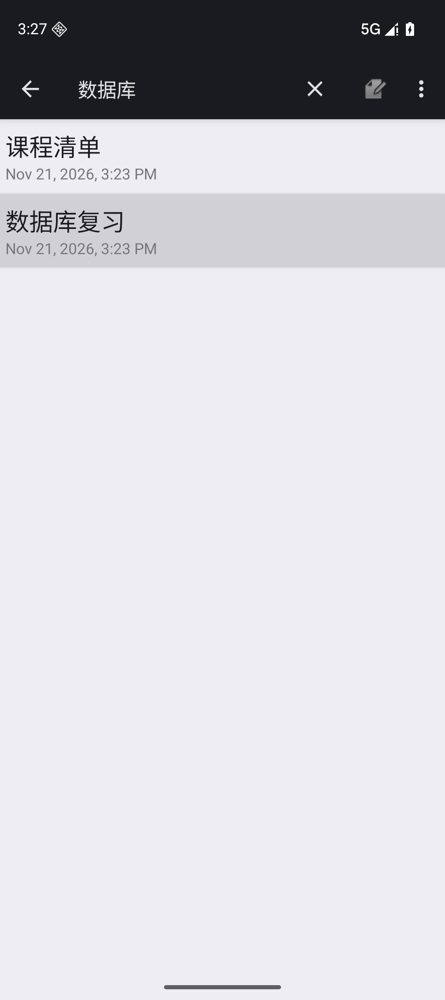 | 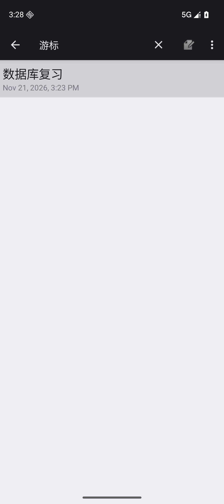 |

---

### 3.4 扩展一（上）：列表主题美化、深浅模式切换与无黑边应用图标（T04）

#### 设计思路
在不引入 `AppCompat` 或第三方 UI 框架、保持 `minSdk 19` 兼容的前提下，对列表首页、修改标题弹窗、系统栏及应用桌面图标进行整体视觉重塑：

1. **极光柔光背景 + 液态毛玻璃卡片**：
   - 新增自定义视图 `AuroraView`，在页面底色上绘制三团薄荷绿、天空蓝、薰衣草紫径向渐变柔光；着色器仅在 `onSizeChanged` 创建一次，逐帧平移画布以约 30 FPS 柔和漂移，窗口失焦或 API 21 以下自动退化为静态画面以兼顾性能与低版本兼容。
   - 在 `PROJECTION` 中追加 `note` 列，卡片内清晰分为三层：粗体标题（最多两行）、折叠空白并剔除重复标题前缀的正文摘要（最多两行，搜索时自动围绕靠后命中位置截取并高亮关键词）、带按 ID 轮换五色圆点与时钟图标的相对修改时间胶囊（`今天／昨天／月日／年月日 + HH:mm`）。
2. **原生无依赖深浅色模式与圆形揭示动画**：
   - 新增 `ThemeHelper`，通过 `SharedPreferences("appearance")` 持久化“跟随系统 / 浅色 / 深色”三种模式。各 Activity 在 `attachBaseContext()` 中调用 `ThemeHelper.applyNightMode()` 覆盖 `Configuration.uiMode`（并将 `fontScale` 置 `0f` 避免覆盖系统字号设置），使系统自动加载 `values/` 或 `values-night/` 中的同名语义色板与资源。
   - 点击顶部月亮／太阳按钮时，通过 `ThemeHelper.captureForReveal()` 截取旧窗口并在重建后首帧以按钮为圆心执行圆形扩散揭示动画；顶部“更多”菜单保留新建、粘贴、外观跟随系统与云备份入口，右下角渐变悬浮新建按钮随列表上滑自动收起、回滑弹出。
3. **双插画空状态与圆角浮动改标题弹窗**：
   - 明确区分“空笔记本”（便签画笔插画 + 引导新建文案）与“搜索无结果”（放大镜插画 + 含当前关键词提示）；`TitleEditor` 保持浮动对话框形态并升级为圆角卡片与渐变“完成”按钮，打开时自动将光标置于末尾。
4. **自适应应用图标与黑边消除**：
   - 经像素级检查，自定义源图标（`1024×1024`）四周存在约 `108px–120px` 的外侧留白及低透明度黑边杂点（如 `(0, 0, 0, 1)`、`alpha=253..254`），直接用作传统图标会在 Android 8.0+ 桌面裁切或暗色壁纸下出现黑边／白边。
   - 解决方案：精确取样图标薄荷底色 `#FFCFF4F3` 作为 `ic_launcher_background` 铺满 `108dp` 自适应背景层；对内部主体（纸张、铅笔、星芒）以原底色做反混色抠图生成纯透明直通 Alpha 的 `ic_launcher_foreground.png`（`mdpi`–`xxxhdpi`）并居中放入 `66dp` 安全区，配置 `mipmap-anydpi-v26/ic_launcher.xml` 与 `ic_launcher_round.xml`；低版本（API 19–25）使用 4 倍超采样圆角矩形／圆形蒙版配合直通 Alpha（`putalpha` 而非黑色预乘混合）生成全套 `mipmap-*` 传统图标，彻底杜绝黑边。

#### 核心代码摘录

```java
// ThemeHelper.java - 无 AppCompat 实现深浅模式覆盖，保留系统字号缩放
static void applyNightMode(Activity activity, Context base) {
    int mode = getMode(base);
    if (mode == MODE_SYSTEM) {
        return;
    }
    Configuration override = new Configuration();
    // API 25 及以下 new Configuration() 会把字号设为 1.0，置 0 表示不覆盖系统字号。
    override.fontScale = 0f;
    int type = base.getResources().getConfiguration().uiMode
            & Configuration.UI_MODE_TYPE_MASK;
    int night = mode == MODE_DARK
            ? Configuration.UI_MODE_NIGHT_YES : Configuration.UI_MODE_NIGHT_NO;
    override.uiMode = type | night;
    activity.applyOverrideConfiguration(override);
}
```

```java
// NotesList.java - 卡片正文摘要生成与关键词薄荷绿高亮
private String buildPreview(String title, String note) {
    if (note == null) {
        return "";
    }
    String text = note.length() > PREVIEW_SOURCE_LIMIT
            ? note.substring(0, PREVIEW_SOURCE_LIMIT) : note;
    text = WHITESPACE.matcher(text).replaceAll(" ").trim();
    String plainTitle = title == null ? "" : WHITESPACE.matcher(title).replaceAll(" ").trim();
    if (!plainTitle.isEmpty() && text.startsWith(plainTitle)) {
        text = text.substring(plainTitle.length()).trim();
    }
    if (isSearching() && !text.isEmpty()) {
        int index = text.toLowerCase(Locale.ROOT)
                .indexOf(searchQuery.toLowerCase(Locale.ROOT));
        if (index > 18) {
            text = "…" + text.substring(index - 10);
        }
    }
    return text;
}
```

```xml
<!-- res/mipmap-anydpi-v26/ic_launcher.xml - 全铺满薄荷底色 + 透明主体前景，消除桌面黑边 -->
<adaptive-icon xmlns:android="http://schemas.android.com/apk/res/android">
    <background android:drawable="@color/ic_launcher_background" />
    <foreground android:drawable="@mipmap/ic_launcher_foreground" />
</adaptive-icon>
```

#### 运行截图

| 浅色模式极光毛玻璃列表 | 深色模式极光毛玻璃列表 | 搜索命中关键词薄荷绿高亮 |
| :---: | :---: | :---: |
| 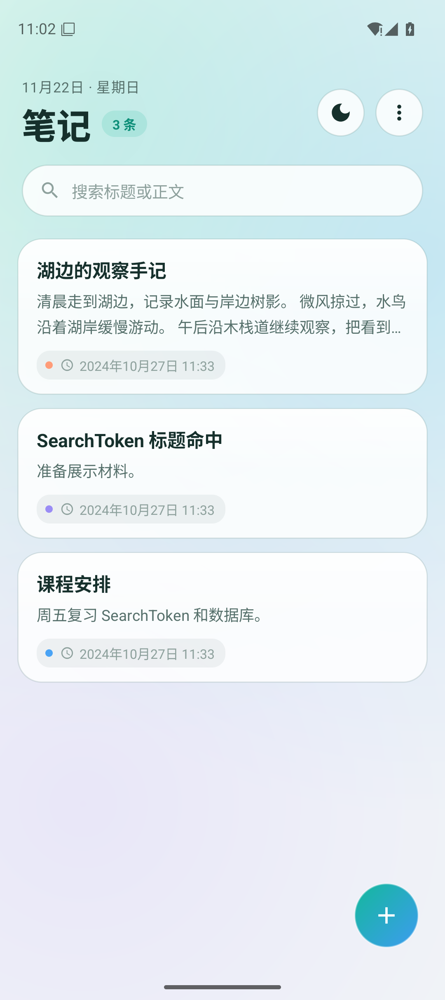 | 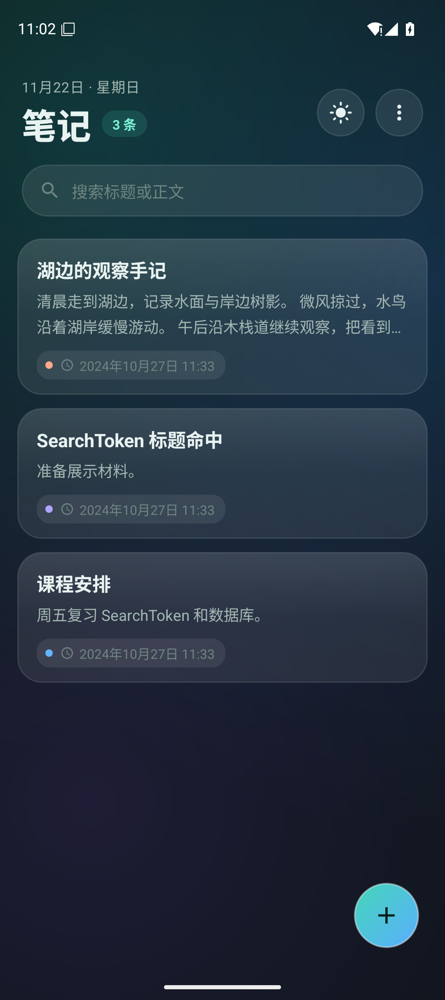 | 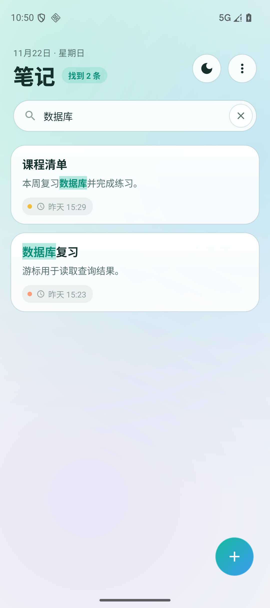 |

| 搜索无结果插画空状态 | 深色模式圆角浮动改标题弹窗 | Pixel 9 桌面自适应图标（右下角，无黑边） |
| :---: | :---: | :---: |
| 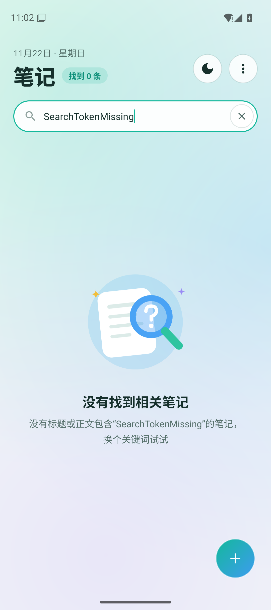 | 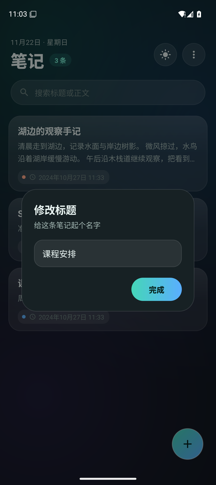 | 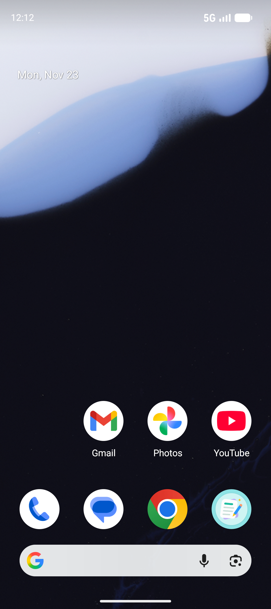 |

---

### 3.5 扩展一（下）：正文编辑器排版优化与白纸／暖纸切换（T05）

#### 设计思路
基于原版 `NoteEditor` 与 `LinedEditText` 升级编辑体验：顶部原生操作栏展示返回箭头、`NotePad` 品牌字样、“纸张”切换菜单、保存勾号与更多菜单；正文置于带细描边与右上角彩色书签的圆角纸张卡片内，笔记标题固定于纸面顶部，正文采用 `18sp` 字号、`6sp` 额外行距与 `20dp` 左右页边距在卡片内独立滚动。

#### 核心实现（`NoteEditor.java`、`note_editor.xml`、`editor_options_menu.xml`）
1. **自适应中文基线的柔和横线绘制**：
   - 在 `LinedEditText.onDraw()` 中仅遍历当前可视区域的排版行，在 `layout.getLineBaseline(line) + 4dp` 处绘制柔和细横线；文字末尾以下的空白区域使用最后两行的实际基线差 `layout.getLineBaseline(last) - layout.getLineBaseline(last - 1)` 延续横线，完美兼容中文回退字体行高。
2. **无感保态切换纸张且不推进修改时间**：
   - 通过 `ThemeHelper.usesWarmPaper()` / `setWarmPaper()` 在全局偏好 `appearance` 中保存 `warm_paper`（独立于深浅模式：浅色提供纯白 `#FFFFFF` 与护眼浅暖纸 `#FFFAF1`，深色提供蓝灰 `#192B37` 与暖棕 `#352E2A`）。
   - 切换纸张时 `applyPaper()` 直接更新当前卡片背景色、边框色、书签色、正文墨色与横线颜色，**不重建 Activity**，因此正在输入的未保存草稿、光标选区、滚动偏移与软键盘展开状态全部保持，且因未修改正文或标题，退出时不会误推 `modified` 时间戳。

```java
// NoteEditor.LinedEditText - 按实际基线与末行基线差续画空白区横线
for (int line = first; line <= last; line++) {
    ruleY = paddingTop + layout.getLineBaseline(line) + baselineGap;
    canvas.drawLine(left, ruleY, right, ruleY, rulePaint);
}
if (last == layout.getLineCount() - 1) {
    // 用实际基线间距延续空白区横线，兼容中文回退字体。
    int step = last > 0 ? layout.getLineBaseline(last) - layout.getLineBaseline(last - 1)
            : getLineHeight();
    step = Math.max(1, step);
    for (float y = ruleY + step; y < bottom; y += step) {
        canvas.drawLine(left, y, right, y, rulePaint);
    }
}
```

#### 验证结果
除界面实测外，新增 `NoteEditorPaperTest` 自动化用例：构造 140 段中文长文并追加未保存草稿、在第 100 段设置 5 字符选区与非零滚动位置后调用纸张切换菜单，断言文本缓冲区对象不变、草稿／选区／滚动偏移／左右 20dp 页边距全部保持，且数据库中正文与 `modified` 毫秒值丝毫未变。在 API 37 与 API 19 上均通过。

| 浅色白纸（薄荷书签与柔和冷灰横线） | 浅色护眼暖纸（`#FFFAF1` 与暖棕书签） | 软键盘展开时输入 `alpha` → 换纸 → 续输 `beta` |
| :---: | :---: | :---: |
| 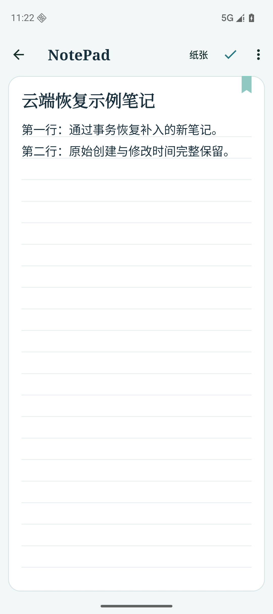 | 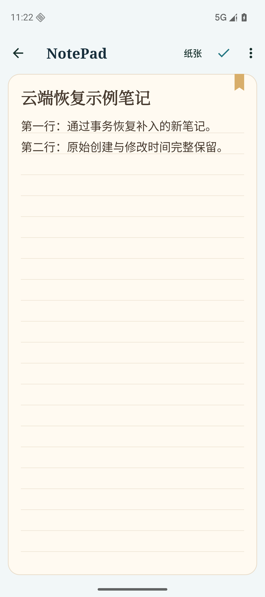 | 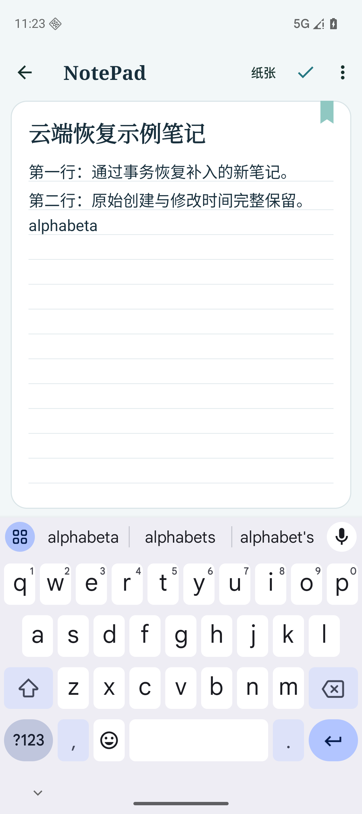 |

---

### 3.6 扩展二（上）：单条笔记导出为 UTF-8 纯文本（T06）

#### 设计思路
充分利用 `NotePadProvider` 原有的单条笔记 `text/plain` 管道流输出（UTF-8 编码、标题 + 空行 + 正文），在列表长按菜单中增加“导出为文本”入口，通过 Android 4.4（API 19）起原生提供的存储访问框架 `Intent.ACTION_CREATE_DOCUMENT` 让用户自选保存目录与文件名，无需申请外部存储权限。

#### 核心实现（`NoteExporter.java`、`NotesList.java`、`list_context_menu.xml`）
1. **真实行 ID 绑定与重建恢复**：长按触发 `R.id.context_export` 时，直接通过 `ContentUris.withAppendedId(getIntent().getData(), info.id)` 构造源笔记 URI 并暂存于 `pendingExportUri`，同步写入 `onSaveInstanceState()`，确保在同名笔记、搜索筛选状态或等待文件选择器返回期间发生 Activity 重建时都不会混淆导出目标。
2. **安全文件名清理**：`NoteExporter.buildSuggestedFileName()` 过滤非法路径与控制字符、去除首尾空格与点号、避免重复 `.txt.txt` 后缀、截断超长主名，空标题自动回退为“笔记.txt”。
3. **后台流复制与落盘保证**：`NotesList` 在独立单线程 `ExecutorService` 中调用 `NoteExporter.exportNoteToUri()`，先校验并打开源端 `AssetFileDescriptor`，再以 `"wt"`（低版本或特殊提供者回退 `"w"`）打开目标输出流透传字节；`finally` 块中优先关闭输出流并向外抛出关闭异常，保证只有在真正落盘关闭完成后才回主线程提示“笔记已导出”。

```java
// NoteExporter.java - 复用 Provider 的 text/plain 管道流并透传到系统文档 URI
sourceAfd = openNotePlainText(resolver, sourceUri);
input = sourceAfd.createInputStream();
output = openWritableOutputStream(resolver, targetUri);
byte[] buffer = new byte[COPY_BUFFER_SIZE];
int bytesRead;
while ((bytesRead = input.read(buffer)) != -1) {
    output.write(buffer, 0, bytesRead);
}
output.flush();
```

#### 验证结果
在模拟器上分别实测了含中文标点与空行的多行笔记导出、两条同名不同正文笔记按 ID 精准区分导出、选择保存位置时按返回取消（不产生文件且源笔记无变化）以及搜索筛选状态下导出；并用系统外部应用 `HTML Viewer` 打开生成的 `.txt` 文件逐字核对无乱码。自动化测试 `NoteExporterTest`（5 项）在 API 37 与 API 19 上全通过。

| 长按菜单“导出为文本” | 系统文档创建器预填建议文件名 | 外部查看器核对中文多行 UTF-8 | 外部查看器核对第二条同名笔记 |
| :---: | :---: | :---: | :---: |
| 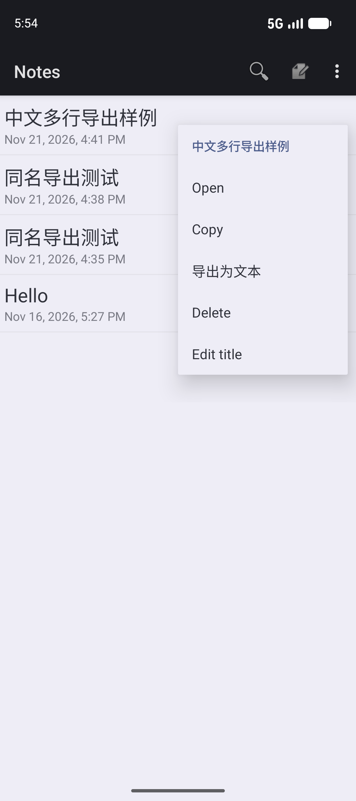 | 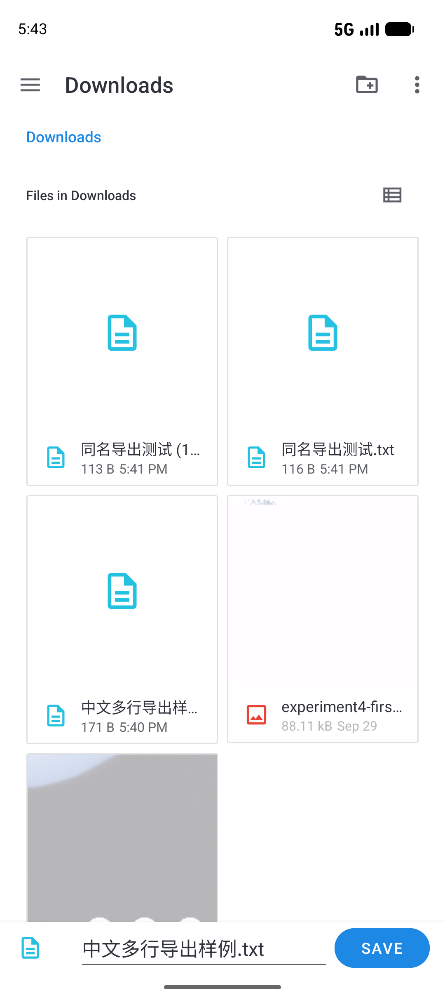 | 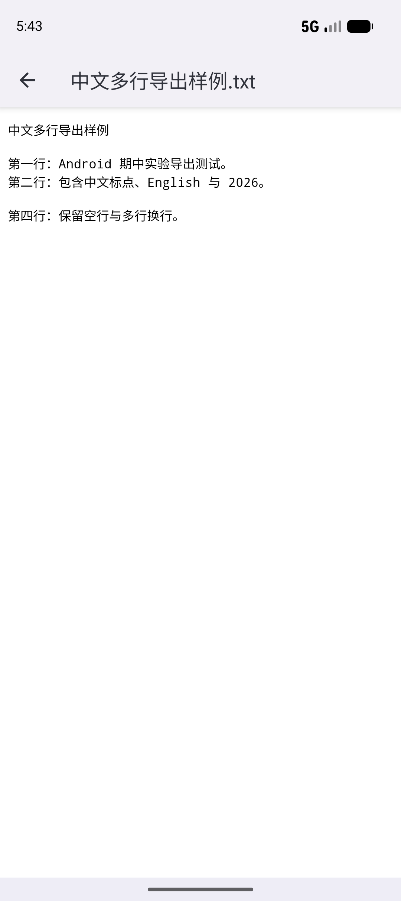 | 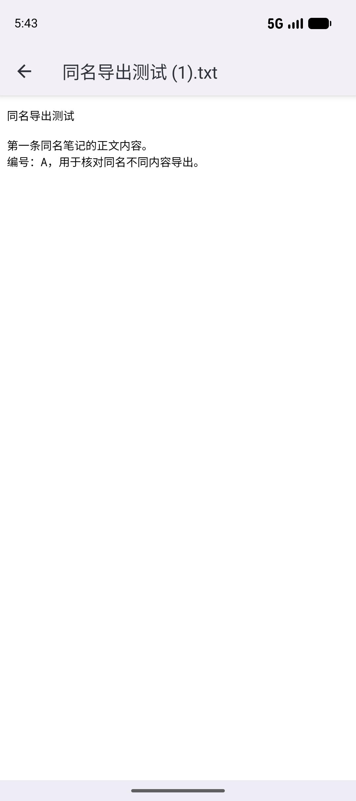 |

---

### 3.7 扩展二（中）：整本笔记 JSON 备份格式与严格校验（T07）

#### 设计思路
为云备份（T08）与云恢复（T09）提供统一的数据契约与零副作用校验器，沿用 Android 平台内置 `org.json` 与 `StandardCharsets.UTF_8` 实现：
- **独立全量查询**：`NoteBackupFormat.queryAllNotes()` 直接以 `NotePad.Notes.CONTENT_URI` 和四列投影（`title`、`note`、`created`、`modified`）无条件查全库，省略本地 `_id` 与本机界面偏好，不受列表搜索状态影响。
- **JSON 格式定义**：顶层固定包含整数 `version`（当前为 `1`）和 `notes` 数组，空库编码为 `{"version":1,"notes":[]}`。
- **防隐式强转的严格校验**：针对 `org.json.JSONObject.getInt/getLong/getString` 会把字符串 `"1"` 或浮点数 `1.5` 静默强转的问题，解码时改用 `opt()` 配合 `instanceof` 逐字段验证真实类型与非负时间戳；用 `JSONTokener` 校验顶层对象后不存在尾随垃圾字符；字节解码开启 `CodingErrorAction.REPORT` 严格拒绝非法 UTF-8 字节序列。错误按 `ErrorCode`（`INVALID_UTF8`、`INVALID_JSON`、`UNSUPPORTED_VERSION`、`INVALID_STRUCTURE`、`INVALID_NOTE_FIELD`）精准分类，校验过程全程在内存中完成，绝不触碰数据库。

```json
{
  "version": 1,
  "notes": [
    {
      "title": "中文多行与符号",
      "note": "第一行：包含\"双引号\"与'单引号'。\n第二行：路径 C:\\notes\\backup.json\n\n第四行：保留空行。",
      "created": 1795250000123,
      "modified": 1795250300456
    }
  ]
}
```

#### 验证结果
`NoteBackupFormatTest`（3 项）在 API 37 与 API 19 上验证了空库往返、4 条含中文/引号/反斜杠/空行/空串/同名异文的“查库 → UTF-8 编码 → 解码 → 逐字段对照”，以及 16 类非法输入（空串、坏 JSON、尾随字符、非法 UTF-8、未知版本、字符串/小数/负数时间戳、缺字段等）全部抛出预期 `ErrorCode` 且数据库原记录完好无损。

---

### 3.8 扩展二（下）：HTTPS WebDAV 手动云备份与单事务云恢复（T08 & T09）

#### 设计思路
用户从列表顶部“更多”菜单进入统一的 `CloudBackupActivity` 页面，填写支持 WebDAV 的云盘（默认以坚果云为例）HTTPS 目录地址（如 `https://dav.jianguoyun.com/dav/NotePad/`）、云盘账号与第三方专用应用密码，在远端固定维护一份 `notepad-backup.json`。

1. **安全与协议边界（`WebDavClient.java`、`CloudBackupActivity.java`）**：
   - **强制 HTTPS 与防凭据泄露**：`normalizeDirectoryUrl()` 仅允许 `https://` 且拒绝查询参数和锚点；在 `HttpURLConnection` 上显式关闭自动重定向（`setInstanceFollowRedirects(false)`），防止携带 `Authorization: Basic` 请求头时被重定向到第三方域名。
   - **密码绝不落盘**：目录地址与账号存入私有 `SharedPreferences("cloud_backup_prefs")`；专用应用密码采用 `textPassword` 掩码输入，仅驻留进程内存静态字段供本次会话复用，绝不写入磁盘、不写入状态 `Bundle`、不出现在日志或异常消息中。
   - **超时、并发锁与状态码分类**：设置连接超时 10 秒、读取超时 15 秒，下载响应体上限 16 MB；使用进程级 `AtomicBoolean` 防止重复并发发起传输；准确区分凭据错误（`401`/`403`）、远端无备份（`404`）、目录不可用（`404`/`409`/`405`/重定向）、服务端异常（`5xx`）与网络中断／超时。
2. **手动备份流程（T08）**：
   - 点击“备份到云端”后在后台独立统计全库条数，弹出确认框说明总条数（空库单独警示 0 条）与覆盖远端 `notepad-backup.json` 的效果；用户确认后发起 HTTPS `PUT` 上传，仅在收到 `201`（首次创建）或 `200`/`204`（覆盖更新）且关闭连接后反馈成功及条数。
3. **先下载校验、再确认、最后单事务恢复（T09）**：
   - 点击“从云端恢复”后先通过 HTTPS `GET` 下载远端文件，立即在后台用 `NoteBackupFormat.decodeFromUtf8Bytes()` 完成完整格式校验；校验失败直接报错且不触碰本地数据库。
   - 校验通过后弹窗告知远端条数及“保留本地已有笔记，仅补入缺失项”规则，用户确认后调用 `NotePadProvider.call(METHOD_RESTORE_MISSING_NOTES, ...)` 在**单次 SQLite 事务**内完成四字段 `(title, note, created, modified)` 计数比对与缺失记录插入：
     - 本地已存在则消耗计数并跳过（保留本地原 ID 与记录）；
     - 缺失项通过 `db.insertOrThrow()` 插入四业务字段（由 SQLite 分配本机新 ID，完整保留原始 `created` 与 `modified`）；
     - 支持同名异文共存、完全相同多条记录按数量精准补齐，重复导入同一备份新增为 0（幂等）；
     - 任一条写入异常时不调用 `setTransactionSuccessful()`，`endTransaction()` 自动整批回滚，确保绝不产生部分写入或破坏本地数据。

#### 核心代码摘录

```java
// NotePadProvider.java - 单次 SQLite 事务内按四字段计数增量补录缺失笔记，中途失败整批回滚
private Bundle restoreMissingNotesInTransaction(NoteBackupFormat.BackupSnapshot snapshot) {
    SQLiteDatabase db = mOpenHelper.getWritableDatabase();
    int restoredCount = 0;
    int skippedCount = 0;

    db.beginTransaction();
    try {
        // 先读取事务内当前本地笔记的四字段计数，支持同名不同正文与完全相同记录按数量补齐。
        Map<NoteBackupFormat.NoteRecord, Integer> existingCounts = queryExistingRecordCounts(db);
        for (NoteBackupFormat.NoteRecord record : snapshot.notes) {
            Integer remaining = existingCounts.get(record);
            if (remaining != null && remaining > 0) {
                existingCounts.put(record, remaining - 1);
                skippedCount++;
                continue;
            }
            // 不传 _ID，由本机数据库分配新行号，同时原样保留备份里的创建与修改毫秒值。
            long rowId = db.insertOrThrow(NotePad.Notes.TABLE_NAME, null, record.toContentValues());
            if (rowId <= 0) {
                throw new SQLException("Failed to restore note row");
            }
            restoredCount++;
        }
        db.setTransactionSuccessful();
    } finally {
        db.endTransaction();
    }

    if (restoredCount > 0 && getContext() != null) {
        getContext().getContentResolver().notifyChange(NotePad.Notes.CONTENT_URI, null);
    }
    ...
}
```

#### 验证结果与运行截图
- 自动化测试 `WebDavClientTest`（6 项）与 `NoteRestoreTest`（4 项，含注入 SQLite `BEFORE INSERT` 触发器强制在第 2 条插入失败并验证第 1 条随之整批回滚）在 API 37 与 API 19 上全部通过。
- 模拟器实测验证了非 HTTPS 拦截、密码不落盘（查验 `shared_prefs/cloud_backup_prefs.xml` 仅含 `directory_url` 与 `username`）、搜索筛选状态下仍统计全库条数确认与取消、不可达地址网络失败恢复、以及向运行中 Provider 注入恢复载荷后列表自动刷新、时间排序正确、重复恢复新增为 0 的全链路表现。

| 云备份与恢复页（浅色极光毛玻璃） | 云备份与恢复页（深色极光毛玻璃） | 筛选列表下仍统计全库条数的确认框 |
| :---: | :---: | :---: |
| 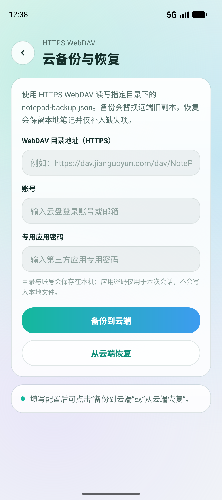 | 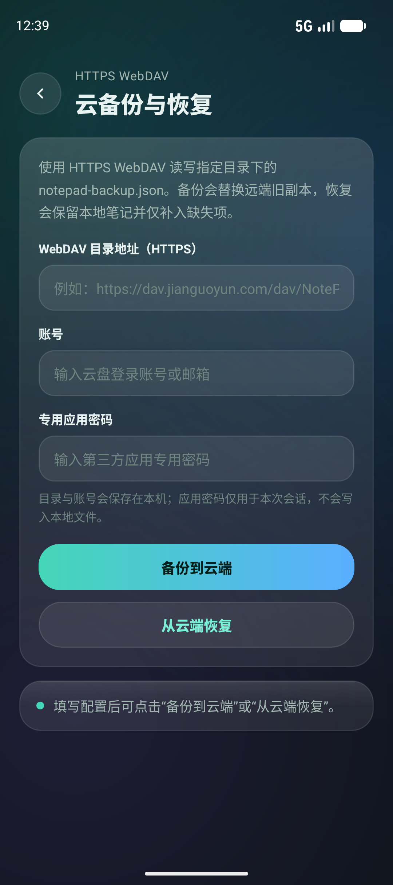 | 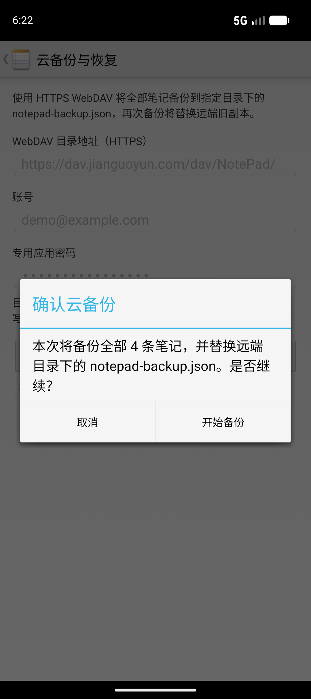 |

| 事务恢复后自动刷新的列表 | 新恢复笔记的详情核对 |
| :---: | :---: |
| 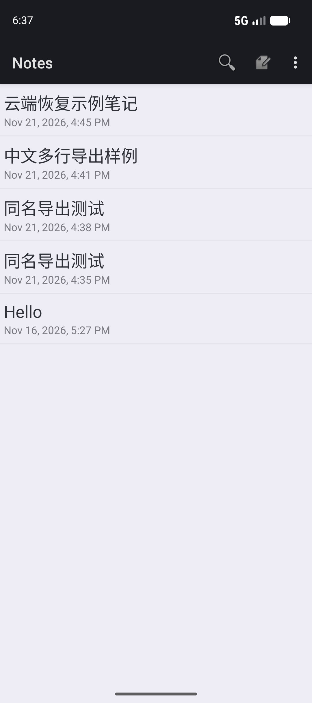 |  |

---

## 四、开发过程中遇到的典型问题与解决方案

| 阶段 | 现象 | 定位原因 | 解决措施与复测结论 |
| --- | --- | --- | --- |
| T03 | 列表第一条笔记与顶部系统操作栏重叠 | 自定义列表根布局延伸到顶部系统区域，未预留系统栏与操作栏偏移 | 为列表根布局补充 `fitsSystemWindows`，复测首行完整落于操作栏下方且点击正常。 |
| T04 | 动态调大 `ListView` 的 `paddingTop` 后，首张卡片仍与半透明搜索栏重叠 | `ListView` 初次布局后再改 `paddingTop` 不会自动重排首行位置，同级视图亦无法实时模糊下方文字 | 改为在全屏 `AuroraView` 之上用垂直 `LinearLayout` 依次排列透明顶部栏与 `ListView`，开启顶部 `fadingEdge`，卡片位置与滚出渐隐均恢复正常。 |
| T04 | 浅色模式下右下角圆形新建按钮四周出现方形浅灰阴影框 | `bg_fab_shape.xml` 使用 `<layer-list>` 导致 `ViewOutlineProvider` 生成矩形轮廓 | 将按钮背景简化为单一 `oval` `<shape>`，系统自动提取圆形轮廓，方形阴影消失。 |
| T05 | 中文多行正文的已排版区横线与下方空白区横线间距不一致 | 中文回退字体使排版行实际基线间距略大于 `getLineHeight()` 默认返回值 | 空白区续画横线改用末两行实际基线差 `layout.getLineBaseline(last) - layout.getLineBaseline(last - 1)`，整页横线间距完全一致。 |
| T05 | 自动化测试通过后列表中残留一条测试笔记 | 旧版 `ActivityInstrumentationTestCase2.tearDown()` 会反射清空子类成员变量，导致清理阶段取不到样本 URI | 在调用 `super.tearDown()` 前将 URI、偏好和上下文保存到局部变量，等待界面空闲后清理，复测后测试库零残留。 |
| 图标适配 | 源图标四周存在低透明度暗色留白，直接导出圆角 PNG 在浅色背景下呈一圈黑边 | 源图外缘含 `(0, 0, 0, 1)` 杂点，且普通图像合成在透明边缘发生黑色预乘混色 | API 26+ 拆分为 `#FFCFF4F3` 纯色背景层 + 反混色透明前景层；低版本用 4 倍超采样蒙版配合直通 Alpha（`putalpha`）导出，在 Pixel 9 暗色桌面与深浅双底预览中均无任何黑边或白边。 |

---

## 五、综合测试与验收总结（T10）

### 5.1 全量自动化仪器测试结果

对最终整合完成的全部代码执行 `./gradlew installDebug installDebugAndroidTest`，并在高版本与最低支持版本两台模拟器上运行全量测试套件（`am instrument -w com.example.android.notepad.tests/android.test.InstrumentationTestRunner`）：

| 测试类 | 覆盖范围 | Android 17 / API 37 (`emulator-5554`) | Android 4.4.2 / API 19 (`emulator-5562`) |
| --- | --- | --- | --- |
| `NotePadProviderTest` | URI/MIME、`text/plain` 管道输出、CRUD、筛选与参数绑定 | 9 项通过 | 10 项通过（含基类默认用例） |
| `NotePadActivityTest` | `NotesList` 正常启动与实例检查 | 1 项通过 | 1 项通过 |
| `NoteEditorPaperTest` | 140 段中文长文换纸保态、选区／滚动偏移／页边距与不改时间戳 | 1 项通过 | 1 项通过 |
| `NoteExporterTest` | 建议文件名清理、UTF-8 中文多行格式、同名区分、覆写截断、失败保护 | 5 项通过 | 6 项通过（含基类默认用例） |
| `NoteBackupFormatTest` | 空库往返、四字段逐项对照、16 类非法输入拒绝与零副作用 | 3 项通过 | 4 项通过（含基类默认用例） |
| `WebDavClientTest` | HTTPS 校验与规范化、PUT/GET 请求头、状态码分类、超时与密码不泄露 | 6 项通过 | 7 项通过（含基类默认用例） |
| `NoteRestoreTest` | 单事务合并、幂等去重、同名异文、重复按量补齐、SQLite 异常整批回滚 | 4 项通过 | 5 项通过（含基类默认用例） |
| **合计** | **7 个测试类全量回归** | **`OK (29 tests)`，耗时 5.213s** | **`OK (34 tests)`，耗时 2.55s** |

### 5.2 实测范围与待补充说明

1. **已完整验证的部分**：
   - 应用在 API 19 至 API 37 均可正常编译安装、无崩溃启动；桌面自适应图标无黑边／白边。
   - 基础功能（时间戳显示与精准更新、标题与正文联合搜索及特殊字符转义）与扩展一（极光毛玻璃列表、深浅色切换与圆形揭示动画、双空状态、浮动改标题弹窗、编辑器白纸／暖纸切换与中文横线排版）均已完成真界面实测与自动化测试。
   - 扩展二中的单条 TXT 导出（含系统文档创建器与外部文本查看器核对）、整本 JSON 编解码与严格校验、WebDAV 协议封装（HTTPS、禁用重定向、超时、状态码分类、密码不落盘）及 Provider 单事务增量恢复与回滚均已完成实测与自动化验证。
   - 回归验证了新建、保存、改标题、撤销修改、长按打开／复制／导出／删除等原有入口，均保持正常。
2. **明确标注的未验证缺口**：
   - **真实公网 WebDAV 云盘（如坚果云）账号端到端往返**：由于实验环境未内置私人云盘账号与第三方应用密码，尚未在真实坚果云目录上执行首次 `PUT` 上传、网页端查看 `notepad-backup.json` 以及在另一设备用真实账号 `GET` 下载恢复的公网实测。后续只需在 `CloudBackupActivity` 中填入测试用坚果云目录地址（如 `https://dav.jianguoyun.com/dav/NotePad/`）、账号与第三方应用专用密码即可直接复测。

---

## 六、快速构建与运行指南

```powershell
# 1. 构建 Debug 应用包与自动化测试包
.\gradlew assembleDebug assembleDebugAndroidTest

# 2. 安装至已连接的 Android 设备或模拟器
.\gradlew installDebug

# 3. 运行全部 7 个仪器测试类
.\gradlew connectedDebugAndroidTest
```

> **提示**：体验 WebDAV 云备份与恢复功能时，请先在支持 WebDAV 的云盘（如坚果云）中创建可写文件夹并生成第三方应用专用密码，在应用列表右上角“更多 → 云备份与恢复”中填写 HTTPS 目录地址、账号及专用应用密码即可开始备份或恢复。
